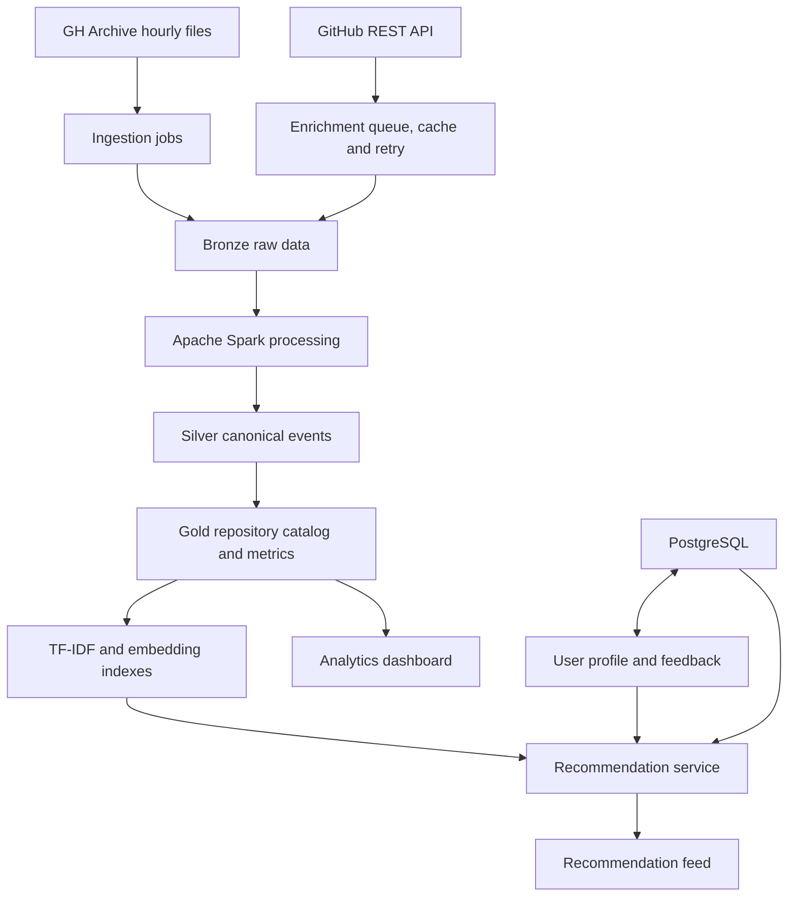
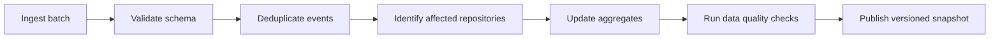

# GitHub Continuous Intelligence Platform

> **Project type:** Distributed Data Engineering & Continuous Analytics  
> **Primary technologies:** Apache Spark, Python, Apache Parquet, PostgreSQL, Docker, Cloud Object Storage  
> **Application layer:** FastAPI, Next.js, TF-IDF, Sentence Transformers  
> **Processing model:** Scheduled hourly batch processing (not millisecond-level streaming)

## 1. Project Overview

GitHub hosts a large and continuously changing collection of open-source repositories. Developers publish projects across many domains, including artificial intelligence, finance, software engineering, data engineering, and developer tooling. Public events such as stars, forks, pushes, issues, and pull requests provide signals about how these repositories evolve.

However, discovering useful repositories is difficult. Popularity-based rankings tend to favor established projects, while keyword searches can miss relevant repositories whose descriptions use different terminology. At the same time, repeatedly processing the complete history of GitHub events to refresh analytics is inefficient as the dataset grows.

The **GitHub Continuous Intelligence Platform** addresses these problems by building a continuously updated repository catalog from public GitHub data. It uses Apache Spark to validate, transform, and aggregate event data; stores historical data in a Bronze/Silver/Gold lakehouse; and serves repository analytics and personalized recommendations through a lightweight application service.

The platform has two connected discovery capabilities:

1. **Personalized Repository Discovery (primary application):** recommend repositories based on a user's interests, technical domains, preferred languages, and workflow needs.
2. **Emerging Repository Signals (supporting capability):** identify repositories with notable recent activity growth, helping surface projects that may be overlooked by lifetime popularity rankings.

The engineering focus is a reliable, replayable, and measurable data pipeline. The recommendation component provides an application-level use case for the curated catalog and enables evaluation of lexical and semantic retrieval methods.

## 2. Problem Statement

Existing repository discovery methods have several limitations:

- **Popularity bias:** rankings based primarily on total stars or other lifetime metrics tend to favor well-established repositories.
- **Keyword mismatch:** users may describe an intended workflow differently from the terminology used in a repository's name, topics, or description.
- **Changing activity:** repository activity changes over time, but static rankings do not necessarily reveal recent momentum.
- **Expensive historical recomputation:** recalculating all historical metrics whenever new events arrive wastes processing resources.
- **Data reliability challenges:** hourly archives may be duplicated, delayed, or temporarily unavailable, and processing jobs may fail partway through execution.

The project investigates how a fault-tolerant distributed data pipeline can maintain an up-to-date repository catalog efficiently and support relevant discovery from large-scale public GitHub activity data.

## 3. Objectives

### 3.1 Engineering Objectives

1. Automatically ingest public GitHub event archives on an hourly schedule.
2. Enrich observed repositories with metadata from the GitHub REST API.
3. Validate, normalize, and deduplicate event records using Apache Spark.
4. Store raw, cleaned, and analytical datasets in a partitioned lakehouse architecture.
5. Incrementally maintain repository-level activity metrics instead of repeatedly recomputing the entire history.
6. Make processing deterministic and recoverable when duplicate, delayed, or out-of-order data arrives or a job fails.
7. Publish validated catalog snapshots for downstream application services.
8. Benchmark processing time, resource usage, scalability, and recovery behavior.

### 3.2 Discovery Objectives

1. Let users describe their interests, preferred programming languages, technical domains, and workflow requirements.
2. Generate repository recommendations using both lexical and semantic matching.
3. Compare TF-IDF and Sentence Transformer retrieval using a controlled evaluation process.
4. Surface recent repository activity trends as additional context for discovery.
5. Collect user relevance and familiarity feedback to evaluate recommendation quality.

## 4. Research Questions

### Primary Research Question

How can a fault-tolerant distributed data pipeline support scalable continuous analytics and timely discovery of relevant and emerging open-source repositories from large-scale GitHub event data?

### Secondary Research Questions

- How does incremental processing compare with repeated full historical recomputation in runtime and resource consumption?
- How do data partitioning and Spark execution settings affect processing time, memory usage, and throughput?
- How reliably can the pipeline recover from duplicate archives, delayed data, out-of-order events, and interrupted processing jobs?
- Does semantic matching improve repository retrieval when user interests and repository descriptions use different terminology?
- Can recent activity-growth signals help surface relevant repositories that are less visible in popularity-based rankings?

## 5. Scope

### 5.1 Minimum Viable Product (MVP)

The MVP focuses on scheduled hourly ingestion and analytics rather than low-latency real-time processing. It includes:

- Hourly ingestion of public GH Archive data.
- GitHub REST API enrichment for observed repositories.
- Bronze, Silver, and Gold data layers stored using object storage and Parquet.
- Spark-based validation, deduplication, aggregation, and incremental catalog updates.
- Repository metadata and activity metrics in a unified catalog.
- TF-IDF baseline retrieval and pretrained Sentence Transformer retrieval.
- A basic user profile and recommendation feed.
- Save/hide/relevance feedback collection.
- Benchmarks for incremental processing, scalability, data integrity, and retrieval quality.

### 5.2 Supporting Feature: Emerging Repository Signals

The system may calculate activity-growth indicators, such as recent observed star additions, pushes, forks, issues, and pull requests. These indicators provide context about recent momentum and can be used as an additional ranking feature after the core recommendation models are evaluated.

Activity growth must not be confused with lifetime popularity. GH Archive records observed public events during the collected period; observed star additions are not the same as a repository's lifetime star total.

### 5.3 Out of Scope for the MVP

The following are optional extensions and are not required for the core project:

- Kafka-based low-latency streaming ingestion.
- Millisecond-level or second-level real-time analytics.
- Collaborative filtering requiring a large user-item interaction history.
- Fine-tuning language models on repository source code or AST representations.
- Advanced time-series forecasting.
- External email, webhook, or Slack notifications.
- Repository recommendation based on code execution or deep static analysis.

## 6. Data Sources

### 6.1 GH Archive

GH Archive provides hourly archives of public GitHub events. It is the primary source for observed repository activity.

Potential event categories include:

| Event type | Example activity signal |
|---|---|
| `WatchEvent` | A user stars a repository |
| `ForkEvent` | A repository is forked |
| `PushEvent` | Commits are pushed to a repository |
| `IssuesEvent` | An issue is opened, edited, or closed |
| `PullRequestEvent` | A pull request is opened, updated, or closed |

The exact event fields and supported event types must be validated against the archive schema used by the ingestion implementation.

Source: [GH Archive](https://www.gharchive.org/)

### 6.2 GitHub REST API

The GitHub REST API enriches repositories observed in event archives with descriptive metadata, such as:

- Repository full name and URL.
- Description.
- Topics.
- Primary programming language.
- Creation and update timestamps.
- Visibility and archived status.
- Other available repository metadata required by the catalog.

The enrichment service should use a request queue, response cache, bounded retries, and API request-budget tracking to manage rate limits and avoid repeatedly requesting unchanged metadata.

Source: [GitHub REST API documentation](https://docs.github.com/en/rest)

### 6.3 Data Coverage Limitation

The catalog represents repositories observed through the collected event archives and successfully enriched through the API. It is not necessarily a complete inventory of all GitHub repositories. Activity metrics derived from GH Archive represent events observed by this pipeline and must not be presented as lifetime totals unless separately obtained from an authoritative metadata field.

## 7. High-Level System Architecture

### 7.1 Offline / Scheduled Processing Zone

The scheduled processing zone is responsible for data ingestion, enrichment, cleaning, aggregation, indexing, and catalog publication. Spark performs batch processing outside the interactive user request path.

### 7.2 Online / User-Facing Zone

The online zone receives user interests, retrieves candidates from prepared indexes, applies ranking logic, and returns a recommendation feed. It should not launch a full Spark job for every user request.

### 7.3 Storage Responsibilities

| Component | Responsibility |
|---|---|
| Cloud Object Storage (e.g. S3) | Durable storage for raw archives and lakehouse datasets |
| Apache Parquet | Columnar file format for efficient analytical reads |
| Apache Spark | Distributed data cleaning, joins, aggregation, and index preparation |
| PostgreSQL | User profiles, feedback, recommendation impressions, and processing metadata |
| FastAPI | Online API for profiles, recommendations, and feedback |
| Next.js | User-facing web application |
| Docker | Reproducible development and deployment environments |

## 8. Data Pipeline Design

### 8.1 Ingestion

A scheduled job runs once per hour and performs the following tasks:

1. Determine the archive time window to ingest.
2. Download the corresponding GH Archive file.
3. Verify download success and record file metadata, such as archive time, checksum, size, and ingestion status.
4. Store the original file in the Bronze layer without destructive modification.
5. Extract unique repository identifiers observed in the archive.
6. Enqueue metadata enrichment requests for repositories not present in the metadata cache or requiring refresh.
7. Record completion status so the job can be retried safely.

The ingestion process must be idempotent: rerunning an ingestion task must not create duplicate logical events or corrupt existing data.

### 8.2 API Enrichment

The enrichment worker processes queued repository metadata requests. It should:

- Cache previously retrieved metadata.
- Avoid unnecessary requests for unchanged repositories.
- Respect GitHub API rate limits and request budgets.
- Retry transient failures with bounded backoff.
- Record permanent failures and make them observable.
- Preserve the timestamp and source of each metadata snapshot.

A repository without successful enrichment may remain in the observed-event dataset but should be marked as having incomplete metadata. The application should not silently treat missing metadata as valid content.

### 8.3 Bronze Layer — Raw Inputs

Purpose: preserve source data for auditing and deterministic replay.

Contents may include:

- Original hourly GH Archive files.
- Raw GitHub API responses or versioned metadata snapshots.
- Ingestion manifests, checksums, and status records.

Bronze data should remain as close to the source as practical. Corrections should normally be implemented in downstream transformations rather than by overwriting source records.

### 8.4 Silver Layer — Canonical Events

Purpose: provide validated and normalized event records for analytics.

Typical transformations:

- Parse and validate source records.
- Normalize timestamps and identifiers.
- Standardize event types and field names.
- Handle malformed or incomplete records according to documented rules.
- Deduplicate records using a stable event identity. The proposed key is `(event_id, repo_id)`; the implementation should verify the uniqueness assumptions against the source data.
- Retain event time and ingestion time so delayed data can be identified.

### 8.5 Gold Layer — Repository Catalog and Analytics

Purpose: publish query-ready repository-level information.

Potential fields include:

- Repository ID and full name.
- Description, topics, and programming language.
- Repository creation time and metadata snapshot time.
- Observed event counts by type.
- Observed star additions over defined windows.
- Push, fork, issue, and pull-request activity over defined windows.
- Last observed activity time.
- Activity-growth or momentum indicators.
- Catalog snapshot version.

Gold outputs should be versioned so the serving service can continue reading the previous valid snapshot while a new snapshot is being built.

## 9. Incremental Processing and Data Integrity

Incremental processing is a central engineering objective. The pipeline should process newly ingested archives and only update the repository aggregates affected by those events, while preserving the ability to backfill delayed data.

### 9.1 Proposed Update Cycle

### 9.2 Correctness and Recovery Requirements

| Failure or data condition | Expected behavior |
|---|---|
| Duplicate archive ingestion | Deduplicate by stable event identity so metrics are not counted twice |
| Delayed or out-of-order archive | Backfill the affected time partitions and update affected repository aggregates |
| Worker or Spark job failure | Replay safely from persisted Bronze inputs or checkpoints; do not publish partial Silver/Gold output |
| Snapshot publication failure | Keep serving the previous valid snapshot |
| Metadata API rate limit or temporary failure | Defer and retry within a bounded policy; retain an explicit enrichment status |
| Invalid source records | Quarantine or record them with a reason; do not silently include them in trusted aggregates |

### 9.3 Snapshot Publication

A new Gold snapshot should only become visible after processing and validation complete successfully. A practical approach is to write each run to a new versioned output location, validate it, and then atomically update a small current-snapshot pointer or manifest. The serving layer continues to use the previous snapshot until the new version is published.

### 9.4 Incremental vs Full Recalculation

The benchmark must compare incremental updates with a full recomputation over the same logical input data. Both methods must produce equivalent aggregate results. A faster result is not acceptable if it omits delayed events or double-counts duplicates.

## 10. Repository Recommendation Design

### 10.1 Inputs and Outputs

**Input:**

- Repository name, description, topics, and programming language.
- User-provided interests, preferred languages, and free-form workflow goals.
- Optional eligibility filters, such as excluding archived repositories or repositories already hidden by the user.

**Output:**

- A ranked list of eligible repositories, initially Top 10.
- Explanatory metadata, such as matching topics and recent activity indicators.
- A record of which repositories were shown to the user, enabling later evaluation.

### 10.2 Baseline: TF-IDF and Cosine Similarity

TF-IDF represents repository text and user interests as weighted term vectors. Cosine similarity is then used to compare the vectors.

Repository text can be constructed from the name, description, topics, and other selected metadata. The implementation should document text preprocessing, tokenization, language handling, and the fields included in the representation.

**Advantages:**

- Lightweight and relatively inexpensive to build and query.
- Interpretable lexical matching behavior.
- Useful as a reproducible baseline.

**Limitation:**

- May perform poorly when users and repositories express similar ideas using different words.

### 10.3 Main Semantic Method: Sentence Transformer

A pretrained Sentence Transformer encodes repository text and user interests into dense semantic vectors. Cosine similarity compares the vectors in a shared embedding space.

Repository embeddings should be generated offline when a catalog snapshot is prepared. User-query embeddings can be generated by the online service, avoiding the need to run Spark during an interactive request.

**Advantages:**

- Can match related concepts, paraphrases, and terminology that does not overlap exactly.
- Supports natural-language descriptions of user needs.

**Trade-offs:**

- Requires embedding generation and index maintenance.
- Uses more memory and computation than a simple TF-IDF baseline.
- Must be evaluated empirically; a more complex model is not automatically more relevant.

The exact pretrained model should be selected and recorded during implementation. The project should not claim that semantic matching is superior before evaluation.

### 10.4 Emerging Activity Signals

Activity features can complement relevance matching. Candidate features include:

- Observed star additions in the recent 24-hour and 7-day windows.
- Recent push, fork, issue, and pull-request counts.
- Change in activity between consecutive time windows.
- Time since the latest observed event.
- Repository age or time since first observation, where available.

A simple initial momentum feature may compare activity in a recent window with activity in a preceding window. Smoothing or minimum-activity thresholds should be considered because very small counts can produce misleading percentage growth.

The system should label these as **observed activity signals**, not as a definitive measure of repository quality or lifetime popularity.

### 10.5 Combined Ranking (Optional Extension)

After evaluating relevance retrieval independently, the platform may test a combined ranking score:

\[
S = \alpha R + \beta M + \gamma N
\]

Where:

- `R` = normalized relevance score from TF-IDF or semantic retrieval.
- `M` = normalized recent activity or momentum score.
- `N` = novelty indicator, such as whether the user has previously seen or saved the repository.
- `α`, `β`, and `γ` = weights selected through controlled experiments.

This combined score is an extension, not a prerequisite for the initial comparison between TF-IDF and Sentence Transformer. To avoid confounding the model comparison, both retrieval methods should first be evaluated using the same candidate catalog, eligibility filters, and ranking protocol without adding different activity-based boosts.

## 11. User-Facing Application

### 11.1 User Profile

Users can specify:

- Technical domains of interest.
- Preferred programming languages.
- Tools, frameworks, and workflows they use.
- Free-form descriptions of the projects or problems they want to explore.

### 11.2 Recommendation Feed

Each recommendation should display relevant repository metadata, such as:

- Repository name and GitHub link.
- Description and topics.
- Primary programming language.
- Matching explanation or matched terms/topics where feasible.
- Recent observed activity indicators.

The feed should distinguish relevance from popularity or momentum. A repository with high recent activity is not necessarily relevant to a particular user.

### 11.3 Feedback

Users can:

- Save a repository.
- Hide a repository.
- Mark a recommendation as not relevant, somewhat relevant, or highly relevant.
- Indicate whether the repository was already familiar to them.

Feedback is stored in PostgreSQL and used for evaluation. It should not be assumed to improve the ranking automatically unless a feedback-learning feature is implemented as a separate extension.

### 11.4 Analytics Dashboard

The dashboard can show:

- Repository activity over time.
- Observed star additions and other event counts.
- Activity comparisons across selected time windows.
- Repository language and topic distributions.
- Emerging activity signals.
- Pipeline freshness and latest successful catalog snapshot.

## 12. Proposed Technology Stack

| Layer | Technology | Responsibility |
|---|---|---|
| Ingestion | Python | Archive downloads, API queue, retries, scheduling |
| Distributed processing | Apache Spark / PySpark | Validation, deduplication, joins, aggregation |
| Data format | Apache Parquet | Columnar analytical storage |
| Object storage | Amazon S3 or compatible object storage | Bronze/Silver/Gold datasets and snapshots |
| Metadata API | GitHub REST API | Repository descriptions, topics, language, and metadata |
| Recommendation | scikit-learn | TF-IDF vectorization and baseline retrieval |
| Semantic retrieval | Sentence Transformers | Text embeddings and semantic similarity |
| Backend | FastAPI | User, recommendation, and feedback APIs |
| Database | PostgreSQL | Profiles, feedback, impressions, and run metadata |
| Frontend | Next.js | User profile, recommendation feed, and dashboard |
| Packaging | Docker | Reproducible local and cloud deployment |

The precise cloud provider, Spark deployment mode, embedding model, and orchestration tool should be selected according to available credits, hardware, and project constraints.

## 13. Evaluation Plan

Evaluation is divided into data-pipeline performance, data correctness, and recommendation quality.

### 13.1 Pipeline Performance

Compare incremental processing with full recomputation using identical input data and equivalent output requirements.

Record:

- End-to-end processing wall-clock time.
- Input data volume and number of processed events.
- Throughput (events processed per second).
- Peak or measured memory utilization.
- CPU utilization where available.
- Object-storage footprint and output size.
- Runtime as the input volume increases.
- Runtime under different Spark worker or executor configurations.

Report the test environment, Spark configuration, dataset size, number of repetitions, and summary statistics so results can be reproduced.

### 13.2 Data Quality and Fault Recovery

Test at least the following conditions:

- Re-ingesting the same archive.
- Processing archives out of chronological order.
- Ingesting a delayed archive after later hours have already been processed.
- Interrupting a processing job before completion.
- Failing snapshot publication.
- Receiving incomplete or invalid metadata responses.

Correctness checks should include event uniqueness, schema constraints, aggregate reconciliation against full recomputation, and confirmation that the serving layer never switches to an invalid partial snapshot.

### 13.3 Recommendation Evaluation

A proposed user study may recruit approximately 15–30 participants, subject to time and resource availability.

Suggested procedure:

1. Ask each participant to submit concrete development interests and preferred technologies.
2. Generate Top-10 results using both TF-IDF and Sentence Transformer.
3. Merge, deduplicate, and shuffle the results while hiding which model produced each recommendation.
4. Ask participants to rate relevance on a three-level scale: not relevant, somewhat relevant, or highly relevant.
5. Ask participants whether they were already familiar with each repository.
6. Calculate the recommendation metrics for each method.

Metrics:

| Metric | Purpose |
|---|---|
| Precision@10 | Fraction of Top-10 recommendations meeting the chosen relevance threshold |
| NDCG@10 | Ranking quality while accounting for graded relevance and rank position |
| Novelty@10 | Fraction of Top-10 recommendations that are both relevant and previously unfamiliar |

The relevance threshold for Precision@10 and the treatment of missing user ratings must be defined before analysis. Results should report participant count and uncertainty or variation where practical. The study should not claim broad generalizability from a small convenience sample.

### 13.4 Retrieval Resource Cost

Record the cost of preparing and querying both indexes:

- Indexing wall-clock time.
- Query latency (p50 and p95).
- RAM utilization.
- Disk or object-storage footprint.
- Embedding generation time and index size for the semantic method.

## 14. Development Roadmap

### Phase 1 — Ingestion Pilot

- Define canonical schemas and ingestion manifests.
- Implement hourly GH Archive download and raw storage.
- Extract observed repository identifiers.
- Build the GitHub API enrichment queue with caching and bounded retries.

**Milestone:** reproducible hourly raw-data ingestion.

### Phase 2 — Distributed Catalog

- Implement Spark parsing and validation.
- Deduplicate canonical events.
- Build Silver event datasets.
- Aggregate repository-level activity metrics.
- Implement versioned Gold catalog snapshots.

**Milestone:** reliable catalog generation from raw archives.

### Phase 3 — Incremental Processing and Serving

- Implement incremental aggregate updates and delayed-data backfills.
- Add deterministic replay and atomic snapshot publication.
- Build TF-IDF and Sentence Transformer indexes.
- Implement FastAPI endpoints and PostgreSQL persistence.
- Build the initial Next.js recommendation feed and profile interface.

**Milestone:** end-to-end discovery application backed by the scheduled data pipeline.

### Phase 4 — Evaluation and Hardening

- Benchmark incremental processing against full recomputation.
- Vary dataset size and Spark worker configuration.
- Run fault-injection and data-integrity tests.
- Conduct the recommendation user study where feasible.
- Document limitations, results, and reproducible setup instructions.

**Milestone:** evaluated and documented project with reproducible experiments.

## 15. Expected Deliverables

1. Reproducible end-to-end ingestion and processing pipeline.
2. Documented GH Archive and GitHub API data ingestion components.
3. Bronze/Silver/Gold lakehouse datasets stored in Parquet.
4. Canonical event schema and repository-level analytical catalog.
5. Incremental processing and backfill implementation.
6. Versioned and safely published catalog snapshots.
7. TF-IDF and Sentence Transformer retrieval implementations.
8. Repository discovery web application with user profile and feedback.
9. Repository activity analytics and optional emerging-activity signals.
10. Performance benchmark results and data-integrity test report.
11. Recommendation evaluation report, including methodology and limitations.
12. Deployment instructions, Docker configuration, and technical documentation.

## 16. Success Criteria

The project will be considered successful when:

- The ingestion workflow can repeatedly collect and preserve hourly public event archives.
- Spark can produce validated Silver and Gold datasets from the raw inputs.
- Duplicate and delayed archives can be handled without corrupting aggregate metrics.
- A failed processing run cannot publish a partial catalog snapshot.
- Incremental processing produces results consistent with a full recomputation for the same logical input data.
- Both TF-IDF and Sentence Transformer can return ranked repository candidates through the application API.
- Users can submit interests, inspect recommendations, and provide feedback.
- Pipeline performance and recommendation quality are evaluated using documented, reproducible methods.

No predetermined performance improvement or recommendation-model winner is assumed. The project should report measured results honestly, including cases where the more complex method does not outperform the baseline.

## 17. Key Risks and Mitigations

| Risk | Mitigation |
|---|---|
| GitHub API rate limits | Queue requests, cache metadata, apply bounded retries, and track request budgets |
| Incomplete repository coverage | Document observed-data coverage and avoid claiming a complete GitHub catalog |
| Duplicate or delayed archives | Stable event identity, idempotent processing, and backfill support |
| Spark cost or excessive runtime | Start with a representative dataset, measure resource use, and tune partitioning only after profiling |
| Misleading activity-growth percentages | Use minimum-volume thresholds, smoothing, and clearly labeled observation windows |
| Recommendation evaluation bias | Blind model identity, use the same candidate catalog and protocol, and define metrics in advance |
| Overly broad project scope | Treat activity-based ranking enhancements and real-time extensions as optional until the MVP is complete |

## 18. References

- GH Archive: https://www.gharchive.org/
- GitHub REST API documentation: https://docs.github.com/en/rest
- Apache Spark documentation: https://spark.apache.org/docs/latest/
- Apache Parquet documentation: https://parquet.apache.org/docs/
- Sentence Transformers documentation: https://www.sbert.net/
- scikit-learn TF-IDF documentation: https://scikit-learn.org/stable/modules/feature_extraction.html#text-feature-extraction

---

## Project Positioning Summary

The GitHub Continuous Intelligence Platform is a **batch-oriented, fault-tolerant data engineering system with a personalized repository discovery application**. Apache Spark and the lakehouse form the engineering core; incremental processing and fault recovery establish the system's reliability; TF-IDF and Sentence Transformer provide a controlled recommendation comparison; and recent activity signals extend discovery beyond static popularity rankings.
